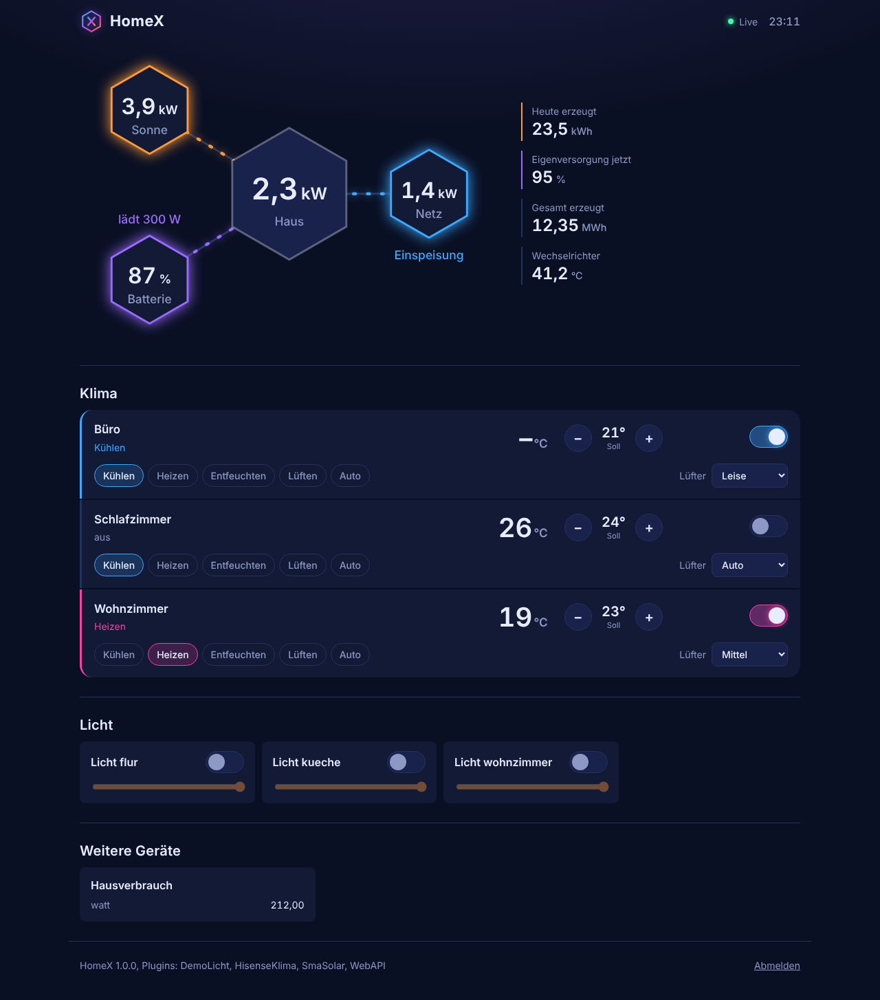

# HomeX – pluginfähiges Smarthome in Java

Aufgebaut wie ein Spigot-Server: `HomeX.jar` starten, alle `.jar`-Dateien im Ordner `plugins/`
werden beim Start geladen und über `onLoad()` → `onEnable()` → `onDisable()` gesteuert.



## Projektaufbau

```
homex/
├── homex-api/            Die Schnittstelle für Plugins (wie die Spigot-API)
│   └── de.homex.api
│       ├── HomeX                     Zentraler Zugriff (wie Bukkit.getServer())
│       ├── plugin/JavaPlugin         Basisklasse jedes Plugins
│       ├── event/                    Events, @EventHandler, Listener
│       ├── device/                   Device, DeviceType, DeviceRegistry
│       ├── command/                  Konsolenbefehle
│       └── scheduler/                Wiederkehrende/verzögerte Aufgaben
├── homex-core/           Der eigentliche Server → baut HomeX.jar
│   └── de.homex.core
│       ├── Main                      Einstiegspunkt
│       ├── HomeXServer               Startet alles, eingebaute Befehle
│       ├── SimplePluginManager       Lädt/aktiviert/deaktiviert die Plugin-JARs
│       ├── PluginClassLoader         Eigener ClassLoader pro Plugin
│       └── DescriptionParser         Liest plugin.yml (ohne externe Bibliothek)
└── homex-plugins/
    ├── demo-licht/       Beispiel-Plugin → baut DemoLicht.jar
    ├── sma-solar/        SMA-Wechselrichter (Modbus/Cloud) → baut SmaSolar.jar
    ├── hisense-klima/    Hisense-Klimas (ConnectLife) → baut HisenseKlima.jar
    └── web-api/          REST-API + Dashboard (PWA) → baut WebAPI.jar
```

## Bauen & Starten

Voraussetzung: Java 25 (JDK) und Maven 3.6.3 oder neuer.

```bash
mvn package

mkdir -p server/plugins
cp homex-core/target/HomeX.jar server/
cp homex-plugins/demo-licht/target/DemoLicht.jar server/plugins/
cd server
java -jar HomeX.jar
```

Oder einfach `start.bat` (Windows) bzw. `./start.sh` (Linux/Mac) – das baut und startet in einem Rutsch.

> Umlaute kaputt in der Windows-Konsole? Vorher `chcp 65001` eingeben.

## Konsolenbefehle

| Befehl | Was er tut |
|---|---|
| `help` | alle Befehle |
| `plugins` | alle Plugins (grün = aktiv, rot = inaktiv) |
| `plugin <name>` | Infos zu einem Plugin |
| `enable <plugin>` / `disable <plugin>` | Plugin zur Laufzeit an-/ausschalten |
| `reload` | alle Plugins entladen, `plugins/` neu einlesen, wieder aktivieren |
| `devices` | alle Geräte mit Zustand |
| `device <id> <schlüssel> <wert>` | Gerät steuern, z. B. `device licht-kueche power on` |
| `stop` | HomeX beenden |

## Ein eigenes Plugin schreiben

### 1. pom.xml – API als `provided`

```xml
<dependency>
    <groupId>de.homex</groupId>
    <artifactId>homex-api</artifactId>
    <version>1.0.0</version>
    <scope>provided</scope>
</dependency>
```

### 2. `src/main/resources/plugin.yml` – Pflicht in jeder JAR

```yaml
name: HisenseKlima
version: 1.0.0
main: de.homex.hisense.HisensePlugin
author: Dennis
description: Steuert die Hisense-Klimaanlagen
depend: []          # Plugins, die vorher da sein MÜSSEN
softdepend: []      # Plugins, die vorher geladen werden, WENN vorhanden
```

### 3. Hauptklasse

```java
public class HisensePlugin extends JavaPlugin {

    @Override
    public void onEnable() {
        saveDefaultConfig();
        getHomeX().getDeviceRegistry().register(new HisenseKlima("klima-schlafzimmer", "Klima Schlafzimmer"), this);
        registerListener(new MeinListener());
        registerCommand("klima", "klima <an|aus>", (sender, label, args) -> { ... return true; });
        getHomeX().getScheduler().runRepeating(this, this::abfragen, 0, 10, TimeUnit.SECONDS);
    }

    @Override
    public void onDisable() {
        // Verbindungen schließen. Geräte, Listener, Befehle und Tasks räumt HomeX selbst auf.
    }
}
```

### 4. Gerät

```java
public class HisenseKlima extends Device {
    public HisenseKlima(String id, String name) { super(id, name, DeviceType.CLIMATE); }

    @Override
    public boolean control(String key, String value) {
        // 1. Befehl an die echte Klima schicken
        // 2. Zustand speichern → löst DeviceStateChangeEvent aus
        return switch (key) {
            case "power" -> updateState("power", value.equals("on"));
            case "mode"  -> updateState("mode", value.toUpperCase());   // COOL, HEAT, DRY, FAN, AUTO
            case "temp"  -> updateState("temp", Integer.parseInt(value));
            default -> false;
        };
    }
}
```

### 5. Auf Events reagieren

```java
public class MeinListener implements Listener {
    @EventHandler
    public void onChange(DeviceStateChangeEvent e) {
        if (e.getDevice().getType() == DeviceType.CLIMATE && e.getKey().equals("temp")
                && (int) e.getNewValue() < 18) {
            e.setCancelled(true);   // unter 18 °C verboten
        }
    }
}
```

## Was der Plugin-Manager für dich erledigt

- **Lade-Reihenfolge** nach `depend` / `softdepend` (topologische Sortierung, Zyklen werden erkannt)
- **Eigener ClassLoader** pro Plugin; Plugins können Klassen ihrer Abhängigkeiten benutzen
- **Fehler-Isolation**: Wirft ein Plugin im `onEnable()` einen Fehler, wird nur dieses Plugin deaktiviert
- **Automatisches Aufräumen** beim Deaktivieren: Tasks, Listener, Befehle und Geräte des Plugins
- **Abhängige Plugins** werden mit deaktiviert (wer `depend: [X]` hat, geht aus, wenn X ausgeht)
- **Reload** gibt die JAR-Dateien frei – Plugin austauschen, `reload` tippen, fertig
- **Eigener Datenordner** `plugins/<Name>/` mit `config.properties`

## Plugins

- [`SmaSolar`](homex-plugins/sma-solar/README.md) – Sunny Tripower per Modbus TCP oder SMA Cloud-API
- [`HisenseKlima`](homex-plugins/hisense-klima/README.md) – Hisense-Klimas (ConnectLife) steuern
- [`WebAPI`](homex-plugins/web-api/README.md) – REST-API mit Live-Updates und das HomeX-Dashboard

## Ideen für die nächsten Plugins

- `Automation` – Regeln wie „Klima an, wenn die Einspeisung über 2000 W liegt“
- `Verlauf` – Messwerte speichern und als Diagramm im Dashboard zeigen
